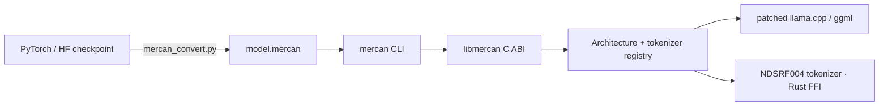

<p align="center">
  <a href="https://mercan.ethosoft.org">
    <picture>
      <source media="(prefers-color-scheme: dark)" srcset="docs/assets/brand-dark.svg">
      
    </picture>
  </a>
</p>

<p align="center">
  
</p>

<h1 align="center">Mercan Runtime</h1>

<p align="center">
  <b>Native local inference for Mercan / NedoLM models.</b><br>
  One self-contained <code>.mercan</code> file, one command: <code>mercan run</code>.
</p>

<p align="center">
  <a href="https://github.com/Ahmet2001/MercanRuntime/actions/workflows/mercan-linux.yml"></a>
  <a href="https://github.com/Ahmet2001/MercanRuntime/actions/workflows/nedo-tokenizer-ffi.yml"></a>
  <a href="https://github.com/Ahmet2001/MercanRuntime/releases/latest"></a>
  <a href="https://huggingface.co/MercanAI/Mercan-0.8B-SFT"></a>
</p>
<p align="center">
  
  
  
  
  
  
</p>

<p align="center">
  <a href="#quick-start">Quick start</a> ·
  <a href="#usage">Usage</a> ·
  <a href="#how-it-works">How it works</a> ·
  <a href="#sdk-and-plugins">SDK &amp; plugins</a> ·
  <a href="#build-from-source">Build</a> ·
  <a href="https://mercan.ethosoft.org">Website</a>
</p>

---

## Features

- **One-command inference.** `mercan run` takes a local `.mercan` file or a Hugging Face repo, downloads it once and caches it.
- **Self-contained model format.** `.mercan` v1 builds on GGUF v3 and embeds the tokenizer assets, identity metadata and a compatibility contract. It contains no executable code.
- **Exact tokenizer.** The original NDSRF004 Rust NedoTokenizer runs through an FFI bridge. Encode/decode is byte-exact and verified by vocabulary SHA-256.
- **CPU or CUDA, chosen for you.** The installer picks the CUDA build when a working NVIDIA driver is present.
- **Turkish chat out of the box.** Chat roles default to `sistem` / `kullanici` / `asistan`, a built-in system prompt is included, and output streams as it is generated.
- **Optional web search.** The CLI queries a self-hosted SearXNG instance, fetches the result pages and hands their text to the model. No API key is needed.
- **Extensible.** A versioned Architecture / Tokenizer SDK, Tensor / Graph / KV ABIs and a dynamic plugin loader let new model families run without patching llama.cpp.

## Quick start

```bash
curl -fsSL https://raw.githubusercontent.com/Ahmet2001/MercanRuntime/main/install.sh | sh
mercan run MercanAI/Mercan-0.8B-SFT
```

## Installation

### Linux x86_64 (prebuilt)

```bash
curl -fsSL https://raw.githubusercontent.com/Ahmet2001/MercanRuntime/main/install.sh | sh
mercan --version
```

The installer downloads the matching archive from the [latest release](https://github.com/Ahmet2001/MercanRuntime/releases/latest). It is configured through environment variables:

| Variable | Default | Purpose |
|---|---|---|
| `MERCAN_PREFIX` | `/usr/local` | Install prefix. Use `$HOME/.local` to install without root. |
| `MERCAN_FORCE_CPU` | `0` | Set to `1` to install the CPU build even on NVIDIA systems. |
| `MERCAN_VERSION` | `latest` | Pin a release tag, e.g. `v0.1.2`. |
| `MERCAN_GITHUB_REPO` | upstream repo | Install from a fork. |

To install without root:

```bash
MERCAN_PREFIX="$HOME/.local" sh install.sh
export PATH="$HOME/.local/bin:$PATH"
```

Each release ships `mercan-linux-x86_64-cpu.tar.gz` and `mercan-linux-x86_64-cuda.tar.gz`, each with a `.sha256` checksum.

## Usage

```text
mercan run <model.mercan | owner/repo[:file.mercan]> [options]
mercan pull <owner/repo[:file.mercan]>
mercan arch list            mercan tokenizer list
mercan graph abi            mercan tensor abi            mercan kv abi
mercan plugin list          mercan plugin load <library>
mercan --version
```

```bash
mercan run ./model.mercan                                  # interactive chat
mercan run MercanAI/Mercan-0.8B-SFT -p "Merhaba"           # single prompt
mercan run model.mercan -s "Sen yardımsever bir asistansın." -p "Merhaba"
mercan run model.mercan --web-search -p "Bugün hava durumu nasıl?"
```

<details>
<summary><b>All run options</b></summary>

| Option | Default | Description |
|---|---|---|
| `-p, --prompt TEXT` | interactive | Single-shot prompt. |
| `-s, --system TEXT` | built-in | System prompt. Pass `""` to disable it. |
| `--role-system / --role-user / --role-assistant NAME` | `sistem` / `kullanici` / `asistan` | Chat role headers. |
| `-n, --max-tokens N` | `256` | Maximum generated tokens. |
| `--temperature F` | `0.7` | Sampling temperature; `0` is greedy. |
| `--top-k N` | `40` | Top-k sampling. |
| `--top-p F` | `0.9` | Nucleus cutoff. |
| `--repeat-penalty F` | `1.15` | Penalty for recently used tokens; `1.0` disables it. |
| `--repeat-last-n N` | `64` | Window the penalty looks at; `0` disables it. |
| `-t, --threads N` | auto | CPU threads. |
| `--gpu-layers N` | `-1` on CUDA | Layers to offload; `-1` offloads all. |
| `--plugin PATH` | — | Load an external architecture/tokenizer plugin. |
| `--web-search` | off | Search the web before every prompt (see below). |
| `--web-search-url URL` | `http://localhost:8080` | SearXNG base URL. |
| `--web-results N` | `3` | Pages fetched per search. |
| `--web-chars N` | `1500` | Characters read from each page. |

</details>

**Model cache.** Hugging Face models are stored in `$MERCAN_CACHE`, then `$XDG_CACHE_HOME/mercan`, then `~/.cache/mercan`. When only `owner/repo` is given, the CLI looks for `model.mercan`.

**Web search.** The model has no tool calling, so the CLI performs the search, fetches the pages and adds their text to the prompt. This requires a [SearXNG](https://github.com/searxng/searxng) instance, for example:

```bash
docker run -d -p 8080:8080 searxng/searxng
```

## Models

| Model | Size | Language | Format | License |
|---|---|---|---|---|
| [MercanAI/Mercan-0.8B-SFT](https://huggingface.co/MercanAI/Mercan-0.8B-SFT) | 0.8B | Turkish | `.mercan` (Q4_K_M) | Apache-2.0 |

## How it works



`libmercan` reads `general.architecture` before the backend loads. It resolves a registered `mercan_architecture_v1` and validates the model against it, then resolves a `mercan_tokenizer_v1`. NedoLM and NDSRF004 are the first built-in providers; dispatch has no special cases for them.

The full contract is in [`spec/MERCAN_FORMAT_V1.md`](spec/MERCAN_FORMAT_V1.md).

## SDK and plugins

### Embedding the inference runtime

Applications can load `libmercan` in-process through the public C API in
`runtime/libmercan/include/mercan.h`. Build with `MERCAN_BUILD_SHARED=ON`
to produce a shared library; the regular Linux CLI package remains static.
The Python integration lives in `ethosoftlib.mercan` in EthosoftLib.

New shared builds expose `mercan_abi_version()`, `mercan_model_params_size()`
and `mercan_context_params_size()`. Bindings should verify ABI 1 and parameter
sizes before calling functions that pass or return structs by value. ABI 1
parameter layouts are frozen; incompatible additions require new entry points.
Keep model/context handles alive for their dependents, and free all models
and contexts before freeing the process-wide backend. Concurrent use of one
context must be serialized by its owner. The C API currently exposes low-level
decode/logits operations; CLI and language SDKs implement generation on top.


| Surface | Header | What it provides | Docs |
|---|---|---|---|
| Architecture / Tokenizer SDK v1 | `mercan_arch.h`, `mercan_tokenizer.h` | Versioned, append-only descriptors for new model families | [ARCHITECTURE_SDK.md](docs/ARCHITECTURE_SDK.md) |
| Tensor ABI v1 | `mercan_tensor.h` | Named weight declarations and opaque `tensor_by_name` / `require_tensor` lookup | [TENSOR_ABI_V1.md](docs/TENSOR_ABI_V1.md) |
| Graph ABI v1 *(experimental)* | `mercan_graph.h` | Backend-independent ops: matmul, RMSNorm, RoPE, SwiGLU, views, concat, `self_attention`, outputs | [GRAPH_ABI_V1.md](docs/GRAPH_ABI_V1.md) |
| KV Cache ABI v1 | `mercan_kv.h` | Opaque views of the runtime-owned base and sliding-window caches | [ARCHITECTURE_SDK.md](docs/ARCHITECTURE_SDK.md) |
| Plugin ABI v1 | `mercan_plugin.h` | Load `.so` / `.dll` providers via `--plugin` or `MERCAN_PLUGINS` | [ARCHITECTURE_SDK.md](docs/ARCHITECTURE_SDK.md#dynamic-plugin-loading) |

```bash
mercan plugin load ./libmercan_arch_anka.so
MERCAN_PLUGINS=./libmercan_arch_anka.so mercan arch list
mercan run model.mercan --plugin ./libmercan_arch_anka.so
```

[`examples/plugins/anka`](examples/plugins/anka) is a separately built transformer plugin. It runs prefill and cached decode on CPU and CUDA through the generic backend, without any Anka class inside llama.cpp. For a minimal starting template, see [`examples/custom_arch`](examples/custom_arch).

### Standalone NedoTokenizer

The NDSRF004 tokenizer also ships as a model-free C library. It provides encode, byte-exact decode, vocabulary size and vocabulary SHA-256, and needs no Mercan runtime or LLM. The API is declared in [`runtime/nedo004-ffi/include/nedo004.h`](runtime/nedo004-ffi/include/nedo004.h).

```bash
cargo build --release --manifest-path runtime/nedo004-ffi/Cargo.toml
```

## Build from source

You need CMake ≥ 3.16, a C++17 compiler, Rust/Cargo, Git and curl.

```bash
git clone https://github.com/Ahmet2001/MercanRuntime.git
cd MercanRuntime
./scripts/build_linux.sh
./dist/mercan-linux-x86_64/bin/mercan --version

# CUDA build (requires the CUDA toolkit)
MERCAN_CUDA=1 MERCAN_DIST_NAME=mercan-linux-x86_64-cuda ./scripts/build_linux.sh
```

The build script:

1. checks out the pinned llama.cpp commit;
2. builds the NDSRF004 Rust bridge;
3. applies `runtime/nedolm/nedolm-llama.patch`;
4. builds `libmercan` and the `mercan` CLI with the backend linked statically.

To build and run the SDK regression tests, add `-DMERCAN_BUILD_SDK_TESTS=ON`.

For iOS builds, see [README-NEDOLM-IOS.md](README-NEDOLM-IOS.md).

## Export and publish a model

```bash
# F16 intermediate + Q4_K_M deployment artifact named model.mercan
./scripts/export_model.sh /path/to/checkpoint.pt /path/to/output

# Publish to Hugging Face (needs a valid huggingface_hub login)
python -m pip install -U huggingface_hub
python scripts/upload_hf.py /path/to/model.mercan --repo MercanAI/Mercan-0.8B-SFT
```

## Repository layout

```text
cli/                     user-facing mercan CLI
runtime/libmercan/       native C ABI and public SDK headers
core/                    architecture/tokenizer registries, plugin loader, generic backend
architectures/nedolm/    built-in NedoLM / NDSRF004 providers
runtime/nedolm/          NedoLM graph and llama.cpp patch
runtime/nedo004-ffi/     exact tokenizer bridge and standalone C SDK
runtime/NedoTokenizer/   tokenizer implementation and assets
examples/                custom_arch template and the anka plugin
scripts/                 build, convert, export and publish tools
spec/  docs/             format contract and ABI documentation
tests/                   ABI compile checks and plugin/backend regressions
```

## Status

v0.1.x includes:

- the portable model format and converter;
- the exact tokenizer bridge;
- the native runtime ABI and SDK registries;
- dynamic plugin loading;
- the local / Hugging Face CLI workflow;
- Linux packaging.

Graph ABI v1 is still experimental. Operations it does not cover yet require compiled backend support. An HTTP server / API layer is planned for a later release.

---

<p align="center">
  Built by <a href="https://ethosoft.org">Ethosoft</a> · <a href="https://mercan.ethosoft.org">mercan.ethosoft.org</a>
</p>
